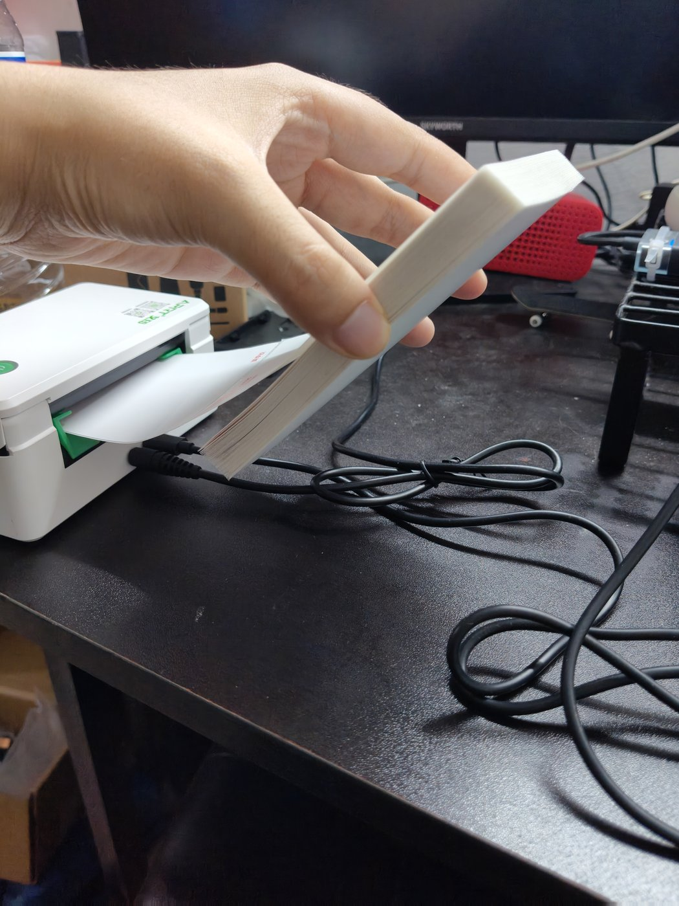
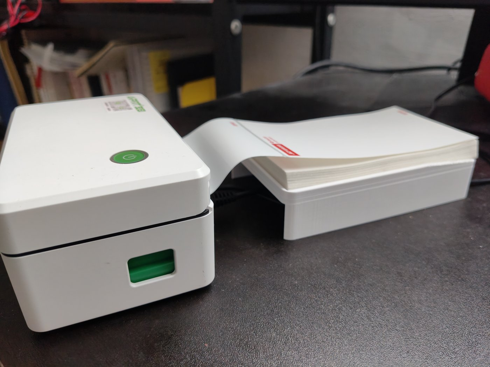
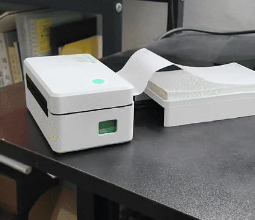
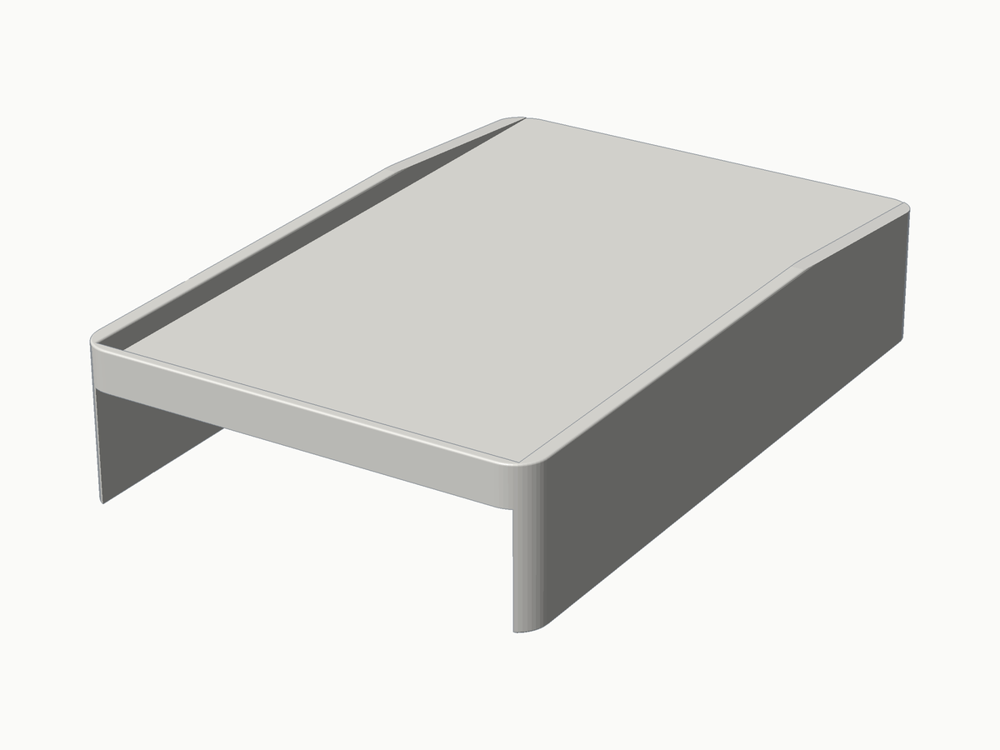

# PaperFlow · 快递面单打印机理线增高架

热敏打印机的电源线和 USB 线从机身后面伸出来，正好占住快递面单要铺的那一片桌面。这个架子把面单抬到 **25 mm** 高度，线缆全部收进架子内部的空腔里，台面上就剩一块平整的板。

- 台面净尺寸 **80 × 130 mm**（正好放 8×13 cm 面单）
- 一体打印，免支撑（**必须侧立打印**，见下）
- 两种厚度：顶板 3.6 mm / 侧壁 3.2 mm，实体体积 **61.9 cm³**，PLA 约 31 g

## 改造前



面单还连在机内纸卷上，出纸后只能摊在打印机后方那一小片桌面上，而电源线和 USB 线也正好盘在那里。纸压到线上就被拱起来，中间架空、边缘翘着，一张也铺不平——只能一只手举着。

## 改造后



台面抬到 25 mm，线缆全部收进架子内部，面单落在平整的板上，打好的几张可以直接摞着。

[](docs/media/riser-demo.mp4)

打印机出一张面单的全过程：纸从机器里出来时还带着纸卷的卷曲，会自己卷成一个圈，得用手压一下才服帖；右边架子上压着之前打好的几张。点开看[原视频](docs/media/riser-demo.mp4)（2.4 s，720×1280）。

## 结构



一块顶板 + 左右两片侧壁，前、后、下三面全通透——线缆从任意方向都能塞进去，不需要对准任何卡扣或开孔。

顶面靠打印机那一侧和左右两边，各有一道 4 mm 高的挡边。面单是连着打印机里的纸卷的，送纸时整张纸都在被往打印机方向拽——这道边就是拦墙，面单被拽到边上就顶住，不会顺着走纸方向一路滑出台面、掉进架子和打印机之间的缝里。

**前面敞开**，并在前 45 mm 做渐隐斜坡（挡边从零高度升到全高）：前面是伸手取面单的一侧，敞口加斜坡，手伸进去或者把面单往里送都不会被边磕到。

| 项目 | 数值 |
|---|---|
| 台面净空（挡边内） | 80 × 130 mm |
| 台面高度 | 25 mm |
| 总高（含挡边） | 29 mm |
| 外廓 | 86 × 133 × 29 mm |
| 顶板 / 侧壁厚 | 3.6 / 3.2 mm |

这个架子改过三版（完整壳体 → 轻量化 → 极简），每一版为什么改、砍掉了什么、踩过哪些坑，都记在 [设计笔记](docs/design-notes.md) 里。

## 打印

| 参数 | 建议值 |
|---|---|
| 材料 | PLA 或 PETG |
| 层高 | 0.2 mm |
| 壁数 | 3 |
| 填充 | 20% |
| 支撑 | **不需要** |
| 摆放 | **侧立**（见下） |

### 摆放方向很重要

这个零件本质上是一个「П 形槽」。如果平放：

- **正放**（顶板朝上）：顶板背面是一大片朝下的平面，跨度 79.6 mm，不加支撑就是一整片塌陷的桥接。
- **倒扣**（顶面朝下）：4 mm 挡边把顶板顶起来，顶板整片悬空，同样需要满片支撑。

正确做法是**侧立**：把模型绕 X 轴转 90°，让 **133 mm 的长边竖直、挡边那一端（后端）朝下贴在热床上**，零件从后端向前端逐层生长。这样每一层的截面几乎完全相同，全是竖直墙，没有悬空面，**既不需要支撑也不需要桥接**。

切片时建议：加 5–8 mm brim（接触面积只有 86×29），外壁速度降到 40 mm/s 左右，关闭桥接检测。

## 文件

```
codes/riser.py       参数化建模脚本（build123d）
codes/render.py      预览渲染器（读 STL 出 PNG，无 CAD 软件时用）
output/riser.stl     可打印网格
output/riser.step    可编辑实体
output/preview_*.png 渲染预览
docs/design-notes.md 设计笔记：三版迭代过程与取舍
docs/images/*.jpg    实拍图：改造前的问题、打印出的实物
docs/media/*.gif     打印过程的循环动图（README 里直接播放）
docs/media/*.mp4     原视频
```

## 改尺寸

`codes/riser.py` 顶部是参数区，改 `W / L / H` 即可，挡边、斜坡、壁厚会跟着联动：

```python
W       = 80.0    # 台面宽度 X —— 面单 8cm
L       = 130.0   # 台面长度 Y —— 面单 13cm
H       = 25.0    # 台面高度 Z —— 增高 2.5cm
TOP_T   = 3.6     # 顶板厚
WALL_T  = 3.2     # 侧壁厚
LIP_H   = 4.0     # 顶面挡边高（0 = 不做挡边）
TAPER_L = 45.0    # 前端挡边渐隐斜坡长度
```

## 重新生成

需要 **Python 3.11**（build123d 依赖的 OCP 没有 3.13 的 wheel）。

```bash
python -m venv .venv
.venv/Scripts/python.exe -m pip install build123d pillow

.venv/Scripts/python.exe codes/riser.py     # 生成 output/riser.stl + riser.step
.venv/Scripts/python.exe codes/render.py    # 生成 output/preview_*.png
```

两个脚本的输出路径都锚定在脚本位置上，从任何目录运行都会写到项目根的 `output/`。

## License

MIT，随便用、随便改、商用也行。
